# Zbiory i wartość eksportu kawy – raport z etapu 2

**Systemy Analizy Biznesowej, ćwiczenie 2:** poznanie danych i koncepcja dashboardu  

**Zespół:** Karol Bystrek, Mateusz Bielówka, Patryk Chamera, Olaf Grykałowski 

## Streszczenie

1. Połączyliśmy dane z pięciu źródeł – zbiory i eksport kawy (FAO), pogodę, światowe ceny kawy i inflację (Bank Światowy) – w jednej bazie danych: 51 krajów, lata 2000–2023.
2. Te 51 krajów daje 89% światowego eksportu kawy, ale 22–44% wartości z FAO to szacunki, a USA okazały się reeksporterem, a nie producentem.
3. Gdy zbiory w kraju spadają o ponad 10%, jego eksport w tym samym roku zwykle też spada (mediana −13%), a wyższa cena rekompensuje mniejszą ilość tylko w co piątym przypadku.
4. Wartość eksportu za kilogram niemal dokładnie podąża za światowymi cenami kawy, a ponad połowa jej wzrostu od 2000 r. to skutek inflacji.
5. Dashboard zbudujemy w Pythonie (biblioteka Streamlit)

**Pojęcia użyte w raporcie**

- **KPI (wskaźnik)** – liczba, którą mierzymy wynik, np. wolumen eksportu.
- **Rok do roku (r/r)** – zmiana w procentach względem poprzedniego roku.
- **Mediana** – wartość środkowa. W przeciwieństwie do średniej nie zmienia jej kilka skrajnych wyników.
- **Korelacja** – liczba od −1 do 1, która mówi, jak bardzo dwie wielkości zmieniają się razem; 0 oznacza brak związku. Używamy korelacji Spearmana, odpornej na wartości skrajne.
- **Ceny stałe (z 2023 r.)** – kwoty przeliczone tak, jakby we wszystkich latach obowiązywały ceny z 2023 r. Usuwają wpływ inflacji.
- **Reeksporter** – kraj, który sprzedaje dalej kawę kupioną za granicą.
- **EDA** – eksploracyjna analiza danych, czyli przegląd danych na wykresach przed właściwą analizą.
- **Wireframe** – szkic układu dashboardu.

## 1. Co zmieniło się od etapu 1

Praca z danymi zmieniła część założeń z opisu projektu.

| Element                   | Było w etapie 1                                       | Jest teraz                                                                                       | Dlaczego                                                                                                                                            |
| ------------------------- | ----------------------------------------------------- | ------------------------------------------------------------------------------------------------ | --------------------------------------------------------------------------------------------------------------------------------------------------- |
| Wskaźniki                 | K1–K5                                                 | K1–K10 i miara pomocnicza M1 (rozdz. 6)                                                          | żeby porównywać ceny z różnych lat, ocenić ryzyko pogodowe i odporność eksportu                                                                     |
| Wskaźniki pogodowe K8, K9 | odniesione do optymalnej pogody dla kawy z literatury | odniesione do normalnej pogody w danym kraju (lata 1991–2020)                                    | średnia pogoda dla całego kraju nie odpowiada górskim plantacjom: w 26 z 29 krajów uprawiających arabikę pogoda ani razu nie mieściła się w optimum |
| Hipoteza H2               | wartość eksportu nie maleje                           | wartość eksportu w cenach stałych nie maleje                                                     | sama inflacja podnosi kwoty, więc bez tej poprawki test byłby zbyt łagodny                                                                          |
| Nowa hipoteza i pytanie   | –                                                     | H3: pogoda a plon; pytanie 6: jaka część wzrostu cen to inflacja                                 | wynikają z nowych wskaźników                                                                                                                        |
| „Słabsze zbiory”          | każdy spadek zbiorów                                  | spadek zbiorów o ponad 10% rok do roku                                                           | wyraźniejszy sygnał w danych i bliższe temu, co klient uzna za słaby rok                                                                            |
| Źródła danych             | FAO (zbiory, eksport), pogoda, ceny kawy              | dodatkowo inflacja w USA, gatunek kawy w kraju (ICO, USDA) i optimum pogody (literatura)         | potrzebne do nowych wskaźników                                                                                                                      |
| Przechowywanie danych     | pliki CSV                                             | baza danych SQLite                                                                               | jedno miejsce na dane i definicje wskaźników, z którego korzystają raport i dashboard                                                               |
| Narzędzie do dashboardu   | Power BI                                              | Python (Streamlit)                                                                               | wygodne w użyciu                                                                                                                                    |
| Kraje w analizie          | 51                                                    | 51 w bazie; 42 w analizie zmian – bez USA i bez krajów eksportujących mniej niż 1 tys. t rocznie | USA sprzedają 12,8 razy więcej kawy, niż zbierają; u bardzo małych eksporterów zmiany procentowe to przypadkowy szum                                |

## 2. Źródła i struktura danych

| Źródło | Co zawiera | Format | Rozmiar | Lata |
|---|---|---|---|---|
| FAOSTAT – produkcja (tylko kawa) | zbiory, powierzchnia upraw i plon | CSV | 20 209 wierszy, 14 kolumn | 1961–2024 |
| FAOSTAT – handel (tylko kawa) | eksport w tonach i w tys. USD | CSV | 25 219 wierszy, 9 kolumn | 1961–2024 |
| Bank Światowy – klimat (ERA5) | średnia temperatura i suma opadów w kraju | JSON | 246 krajów × 76 lat | 1950–2025 |
| Bank Światowy – ceny surowców | światowe ceny arabiki i robusty [USD/kg] | Excel | 66 lat × 70 surowców | 1960–2025 |
| Bank Światowy – inflacja | wskaźnik cen w USA (CPI, 2010 = 100) | JSON | 24 lata | 2000–2023 |
| ONZ – kody krajów (M49) | kody krajów i podział na regiony | HTML | 248 krajów | – |
| ICO (Międzynarodowa Organizacja Kawy) | dominujący gatunek kawy w kraju | Excel | 54 kraje | 1990–2020 |
| DaMatta i Ramalho (2006) | optymalna temperatura i opady dla arabiki i robusty | tabela wpisana ręcznie | 2 wiersze | – |

**Jak łączymy dane.** Kluczem jest para **kraj + rok**. Kraje rozpoznajemy po kodach (ISO3, M49), a nie po nazwach, bo nazwy różnią się między źródłami, np. „United Republic of Tanzania” w FAO i „Tanzania” w ICO. Ceny kawy i inflację łączymy tylko po roku, bo są wspólne dla całego świata.

**Wynik połączenia.** Z 75 krajów produkujących kawę 74 mają jakiekolwiek dane o eksporcie, a 51 ma pełne dane za wszystkie 24 lata. Te 51 krajów daje 89% światowego eksportu kawy w 2023 r. Pozostałe 24 kraje wykluczyliśmy – żaden nie miał więcej niż 0,24% światowego eksportu.

**Profil najważniejszych kolumn** (1224 wiersze = 51 krajów × 24 lata; każda para kraj + rok występuje dokładnie raz; typy kolumn są w załączniku A):

| Kolumna | Znaczenie | Braki | Unikalne wartości | Najmniej | Mediana | Najwięcej |
|---|---|---|---|---|---|---|
| production_t | zbiory [t] | 0% | 1165 | 1 | 32 035 | 3 705 719 |
| yield_kg_ha | plon [kg/ha] | 0% | 1132 | 82 | 647 | 3 916 |
| export_t | wolumen eksportu [t] | 0% | 1165 | 0 | 11 141 | 2 372 633 |
| export_value_usd | wartość eksportu [mln USD] | 0% | 1163 | 0 | 18,2 | 8 514 |
| usd_per_kg | wartość eksportu za kg [USD] | 1,7% | 1186 | 0,29 | 2,67 | 125,00 |
| usd_2023_per_kg | to samo w cenach z 2023 r. [USD] | 1,7% | 1203 | 0,36 | 3,58 | 155,38 |
| temperature_c | średnia roczna temperatura [°C] | 0% | 644 | 6,6 | 24,2 | 27,8 |
| precipitation_mm | roczna suma opadów [mm] | 0% | 1222 | 93 | 1 571 | 4 897 |
| arabica_usd_kg | światowa cena arabiki [USD/kg] | 0% | 22 | 1,36 | 3,12 | 5,98 |
| robusta_usd_kg | światowa cena robusty [USD/kg] | 0% | 24 | 0,61 | 1,89 | 2,63 |

Braki w wartości za kg (1,7%) to lata, w których kraj nic nie wyeksportował – wtedy nie da się podzielić wartości przez ilość. Skrajne wartości (np. 125 USD/kg) omawiamy w rozdziale 5.

## 3. Jakość danych

### 3.1 Ocena jakości

| Cecha | Co znaleźliśmy | Co z tym robimy |
|---|---|---|
| Kompletność | 24 z 75 krajów nie ma pełnych danych o eksporcie (maks. 0,24% światowego eksportu) | wykluczamy je; lista jest w pliku `excluded_export_countries.csv` |
| Kompletność | 21 lat bez eksportu w 5 krajach (np. Sri Lanka, Filipiny) | w tych latach nie liczymy wartości za kg |
| Kompletność | 6 krajów bez gatunku kawy w danych ICO | Chinom (arabika) i Malezji (robusta) przypisaliśmy gatunek według raportu USDA; 4 kraje, w tym USA, zostają bez gatunku |
| Spójność | różne nazwy krajów w różnych źródłach | łączymy po kodach krajów; 4 nazwy z ICO przypisaliśmy ręcznie |
| Spójność | FAO podaje też sumę dla Chin razem z Tajwanem, Hongkongiem i Makau, co dublowałoby dane | używamy tylko Chin kontynentalnych |
| Spójność | wartość eksportu w tys. USD, ceny w USD/kg, wszystko w cenach z danego roku | mnożymy wartość przez 1000; ceny stałe liczymy jednym wskaźnikiem inflacji |
| Aktualność | dane kończą się na 2023 r.; źródła były aktualizowane w latach 2025–2026 | zostajemy przy latach 2000–2023; dwuletnie opóźnienie nie przeszkadza w wyborze dostawców |
| Poprawność | 22–44% wartości z FAO to szacunki, a nie dane oficjalne | zostawiamy przy każdej wartości oznaczenie (flagę) jej pochodzenia |
| Poprawność | 309 zmian o ponad ±50% rok do roku, głównie w eksporcie | nie usuwamy ich; w porównaniach używamy mediany i pomijamy bardzo małych eksporterów |
| Poprawność | w 152 przypadkach eksport był większy niż zbiory; USA eksportują 12,8 razy więcej, niż zbierają | to zapasy z poprzednich lat i reeksport; USA wyłączamy z wyboru dostawców |
| Poprawność | 150 przypadków, w których wartość za kg jest ponad 2 razy wyższa lub niższa od ceny światowej | sprawdzamy je ręcznie (rozdz. 5) |
| Poprawność | pogoda to średnia dla całego kraju, a nie dla plantacji | wskaźniki pogodowe liczymy względem normy kraju, a nie optimum z literatury |

### 3.2 Reguły jakości danych

Reguły R1–R7 muszą być spełnione – jeśli nie są, budowa bazy się zatrzymuje. Reguły R8–R11 tylko oznaczają wiersze do sprawdzenia; ich lista jest w pliku `dq_review.csv`.

| Nr | Reguła | Ważność | Jak jej pilnujemy | Naruszenia |
|---|---|---|---|---|
| R1 | para kraj + rok występuje tylko raz i nie jest pusta | krytyczna | klucz główny w bazie | 0 |
| R2 | każdy kraj i rok z danych istnieje w tabelach opisujących kraje i lata | krytyczna | klucz obcy w bazie | 0 |
| R3 | zbiory i eksport są w tonach, a wartość w tys. USD | krytyczna | kontrola jednostek przed załadowaniem | 0 |
| R4 | zbiory, eksport i wartość nie są ujemne | krytyczna | warunek w bazie | 0 |
| R5 | kraj ma dane o eksporcie we wszystkich 24 latach | wysoka | wykluczenie kraju przy budowie bazy | 0 |
| R6 | każdy rok ma inflację i obie ceny kawy | wysoka | pola wymagane w bazie | 0 |
| R7 | nie dzielimy przez zero, np. przy zerowym eksporcie | wysoka | wzór wskaźnika | 0 |
| R8 | zbiory lub eksport zmieniły się o ponad ±50% rok do roku | średnia | oznaczenie do sprawdzenia | 309 |
| R9 | eksport jest większy niż zbiory | średnia | oznaczenie do sprawdzenia | 152 |
| R10 | wartość za kg jest poza zakresem 0,5–2 × cena światowa gatunku | średnia | oznaczenie do sprawdzenia | 150 |
| R11 | plon nie zgadza się z ilorazem zbiorów i powierzchni (±5%) | niska | oznaczenie do sprawdzenia | 1 |

## 4. Model danych i baza

Dane trzymamy w bazie SQLite (`data/coffee.db`, 192 KB) w układzie gwiazdy: w środku jest jedna tabela z faktami, a wokół niej tabele opisujące kraje i lata.

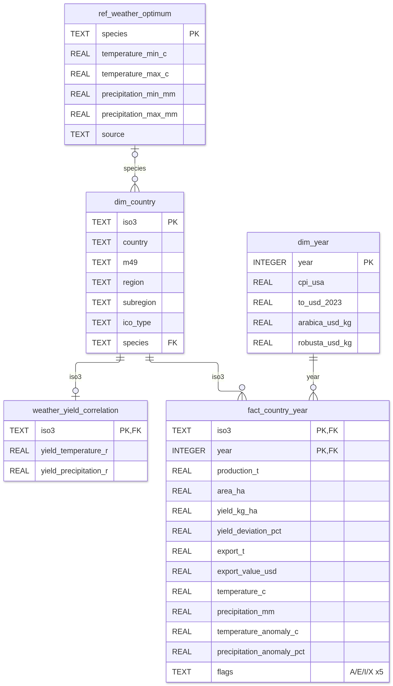

- **fact_country_year** – jeden wiersz na kraj i rok: zbiory, plon, eksport i pogoda (1224 wiersze).
- **dim_country** – opis kraju: nazwa, region, gatunek kawy i typowa zmienność pogody (51 wierszy). Jest też **tabelą mapowań**: łączy nazwę kraju z FAO z kodami M49 i ISO3, regionem i gatunkiem.
- **dim_year** – ceny arabiki i robusty oraz inflacja dla każdego roku (24 wiersze).
- **ref_weather_optimum** i **weather_yield_correlation** – tabele pomocnicze: optimum pogody z literatury i korelacje pogody z plonem.
- Wskaźniki liczą dwa **widoki**, czyli zapisane zapytania: `v_kpi_country_year` dla kraju i roku oraz `v_kpi_country` dla całego kraju. Raport i dashboard korzystają z tych samych definicji.

Słownik danych (opis wszystkich kolumn) jest w załączniku A.

## 5. Eksploracyjna analiza danych (EDA)

Wykresy E1 i E2 obejmują wszystkie kraje. Analizy zmian, cen i pogody (E3–E7) obejmują 42 kraje: pomijamy USA (reeksporter) i 8 krajów eksportujących średnio mniej niż 1 tys. t rocznie. Te 8 krajów to tylko 0,01% eksportu, ale aż 98 z 260 zmian eksportu o ponad ±50%.

### E1. Rozkład wolumenu eksportu i wartości za kg

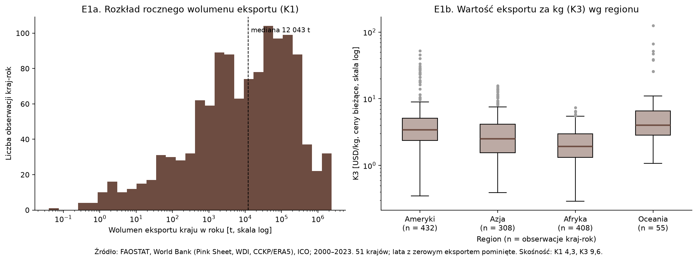

Większość krajów eksportuje niewiele, a kilka bardzo dużo: mediana to 12 tys. t na kraj i rok, a największe wartości przekraczają 2 mln t. Dlatego w porównaniach używamy mediany, a nie średniej. Wartość za kg jest najwyższa w Ameryce (mediana 3,42 USD) i Oceanii (4,04 USD), a najniższa w Afryce (1,93 USD). Ameryki sprzedają głównie droższą arabikę, a Afryka i Azja w dużej części tańszą robustę.

### E2. Najwięksi eksporterzy

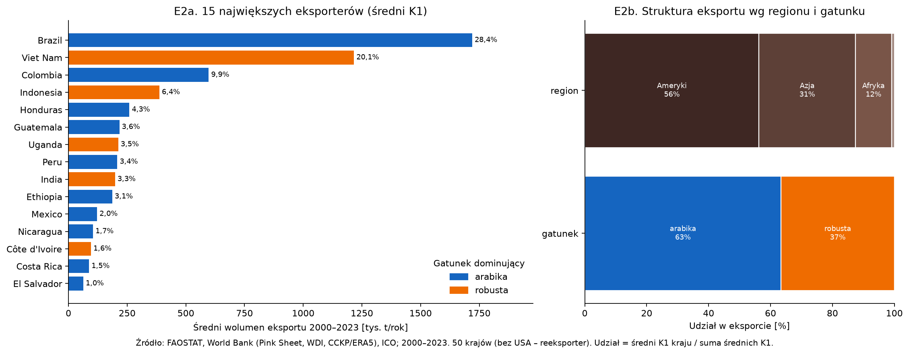

Rynek jest skoncentrowany: Brazylia, Wietnam i Kolumbia dają razem 58% eksportu. Ameryki odpowiadają za 56% eksportu, Azja za 31%, a Afryka za 12%; arabika to 63% eksportu, robusta 37%. Poza Brazylią i Wietnamem jest dziewięć krajów z udziałem 2–10% – wśród nich warto szukać dodatkowych dostawców.

### E3. Trend eksportu

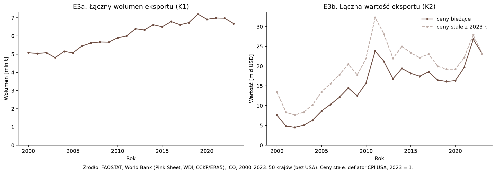

W latach 2000–2023 ilość eksportowanej kawy wzrosła o 31% (z 5,1 do 6,7 mln t), a jej wartość o 203%. Po usunięciu inflacji wartość wzrosła o 71%. Większość wzrostu wartości to więc wyższe ceny, a nie więcej kawy.

### E4. Wartość za kg a ceny światowe (pytania 5 i 6)

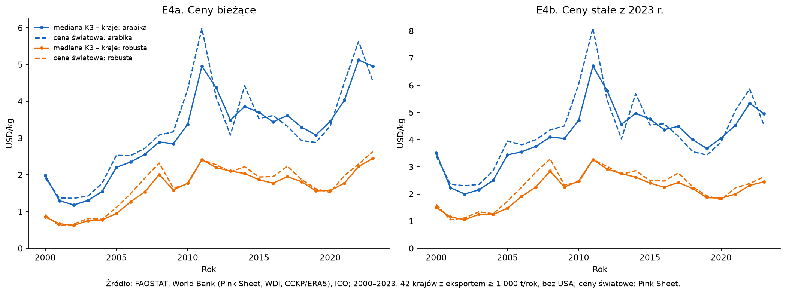

Wartość eksportu za kg niemal dokładnie podąża za ceną światową: korelacja wynosi 0,95 dla krajów arabikowych i 0,96 dla robustowych, a typowy kraj sprzedaje za 94–95% ceny światowej. Średnia wartość za kg wzrosła z 1,13 USD w latach 2000–2004 do 2,94 USD w latach 2019–2023, czyli o 161%. W cenach stałych wzrost wynosi 68%, więc inflacja odpowiada za około 58% wzrostu.

### E5. Zbiory a eksport (hipoteza H1, pytanie 2)

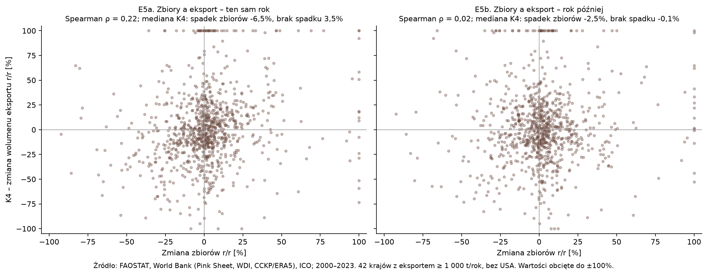

Słabsze zbiory obniżają eksport głównie w tym samym roku. W latach, w których zbiory spadły, eksport zmienił się o −6,5% (mediana), a w pozostałych latach o +3,5%. Rok później różnica prawie znika (−2,5% wobec −0,1%). Związek jest słaby (korelacja 0,22), co sugeruje, że część krajów łagodzi spadki zapasami.

### E6. Pogoda a plon (hipoteza H3, pytanie 4)

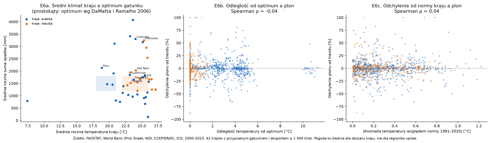

Średnia temperatura kraju mieści się w optimum z literatury tylko w 5 z 28 krajów arabikowych (E6a). To średnia dla całego kraju, a kawa rośnie wyżej w górach, gdzie jest chłodniej. Ani odległość od optimum (E6b), ani odchylenie od normalnej pogody w kraju (E6c) nie wiąże się z wahaniami plonu – korelacje wynoszą −0,04 i 0,04. Dlatego wskaźniki pogodowe traktujemy tylko jako tło, a nie kryterium wyboru dostawcy.

### E7. Związki między zmiennymi

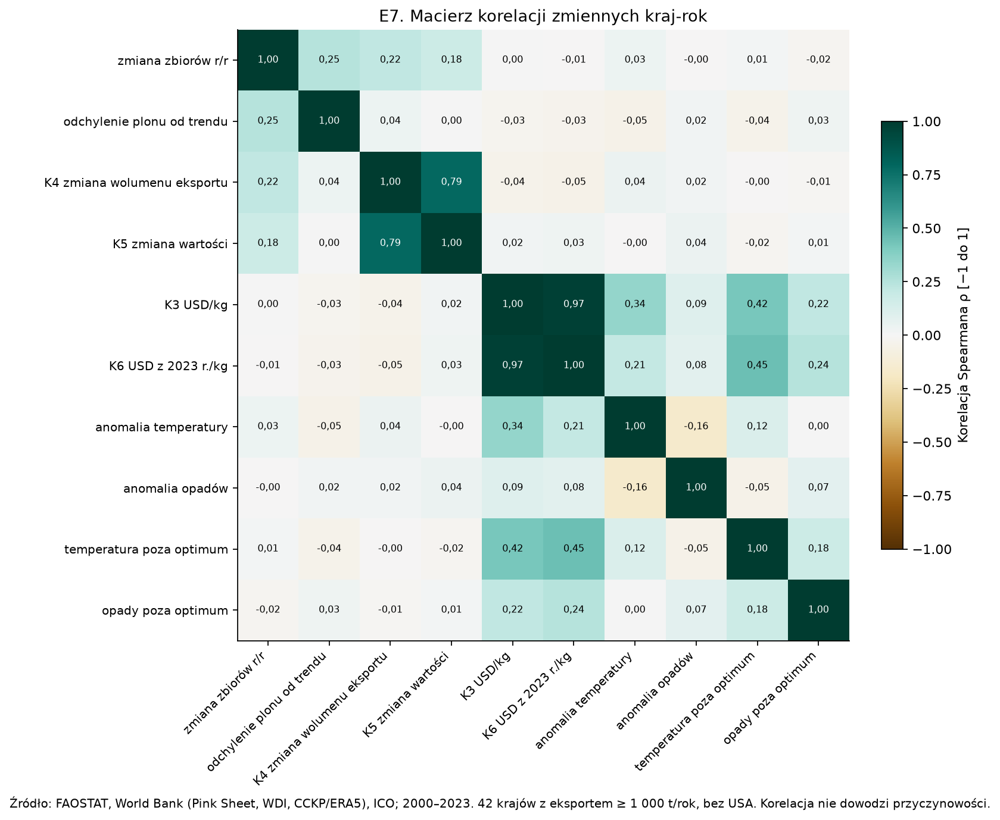

Najsilniejszy związek łączy zmianę ilości eksportu ze zmianą jego wartości (0,79), więc wartość eksportu zmienia się głównie przez ilość (pytanie 1). Wartość za kg jest powiązana z temperaturą (0,34–0,45), ale to związek pozorny: ceny i temperatury rosły w tym samym czasie, a kraje uprawiające droższą arabikę mają średnią temperaturę daleko od jej optimum.

### Hipotezy – wstępne wyniki

Wyniki są wstępne: porównujemy mediany, bez testów statystycznych.

| Hipoteza                                                 | Wynik                                                                                                                               | Ocena           |
| -------------------------------------------------------- | ----------------------------------------------------------------------------------------------------------------------------------- | --------------- |
| H1: słabsze zbiory obniżają eksport                      | przy spadku zbiorów o ponad 10%: eksport −12,8% wobec +1,7% w pozostałych latach; rok później −3,6% wobec −0,4%                     | potwierdzona    |
| H2: wyższa cena rekompensuje mniejszą ilość (ceny stałe) | wartość eksportu nie spadła tylko w 21% z 499 przypadków ze spadkiem ilości - wyższa cena zwykle nie rekompensuje mniejszej ilości. | niepotwierdzona |
| H3: pogoda poza normą obniża plon                        | odchylenie plonu od trendu: +0,1% w normie i +0,1% poza normą                                                                       | niepotwierdzona |

### Wartości odstające

Nic nie usuwamy – tylko oznaczamy i sprawdzamy. 150 przypadków, w których wartość za kg mocno odbiega od ceny światowej, dzieli się na trzy grupy:

- **bardzo mały eksport** (62 przypadki, np. Trynidad i Tobago, Nepal) – to szum; te kraje pomijamy w analizie zmian,
- **kawa wyraźnie droższa** (59 przypadków w 10 krajach) – częściowo prawdziwa kawa premium, np. Jamajka (Blue Mountain, 8 razy drożej niż światowa cena arabiki) i Jemen; Tajlandię trzeba sprawdzić,
- **kawa podejrzanie tania** (29 przypadków w 7 krajach) – np. Timor Wschodni, Togo i Gwinea sprzedają za 25–34% ceny światowej; to prawdopodobnie błędy w danych, które sprawdzimy w etapie 3.

### Podsumowanie EDA

1. Rynek jest skoncentrowany (3 kraje dają 58% eksportu), ale jest dziewięciu średnich eksporterów z udziałem 2–10%.
2. Wartość eksportu rośnie głównie dzięki cenom, a nie ilości: ilość +31%, wartość w cenach stałych +71%.
3. Wartość za kg podąża za cenami światowymi (korelacja 0,95–0,96), a 58% jej wzrostu to inflacja.
4. Słabsze zbiory obniżają eksport w tym samym roku (mediana −12,8%). To potwierdza sens wskaźnika odporności eksportu (K10).
5. Wyższa cena rzadko rekompensuje mniejszą ilość – tylko w 21% przypadków.
6. Pogoda liczona jako średnia dla kraju nie wyjaśnia wahań plonu, więc wskaźniki pogodowe są tylko tłem.
7. Dane wymagają ostrożności: 22–44% wartości z FAO to szacunki, a część skrajnych cen to prawdopodobnie błędy.

## 6. Wskaźniki (KPI)

| Wskaźnik | Jak go liczymy | Jednostka | Źródło | Po co hurtowni |
|---|---|---|---|---|
| K1 Wolumen eksportu | ilość wyeksportowanej zielonej kawy | t | FAOSTAT | czy kraj udźwignie dodatkowe zamówienia |
| K2 Wartość eksportu | wartość eksportu; także w cenach z 2023 r. | USD | FAOSTAT, Bank Światowy | jak ważna jest kawa w handlu kraju |
| K3 Wartość za kg | K2 / (K1 × 1000) | USD/kg | FAOSTAT | średni poziom cen kraju – punkt odniesienia w negocjacjach |
| K4 Zmiana wolumenu | zmiana K1 rok do roku | % | FAOSTAT | czy dostawy są stabilne |
| K5 Zmiana wartości | zmiana K2 rok do roku; także w cenach stałych | % | FAOSTAT, Bank Światowy | czy wyższa cena rekompensuje mniejszą ilość (H2) |
| K6 Wartość za kg w cenach stałych | K3 przeliczone na ceny z 2023 r. wskaźnikiem inflacji w USA | USD z 2023 r./kg | FAOSTAT, Bank Światowy | czy kraj drożeje naprawdę, czy tylko przez inflację |
| K7 Pogoda a plon | korelacja temperatury (osobno opadów) z plonem w latach 2000–2023 | od −1 do 1 | FAOSTAT, Bank Światowy | jak bardzo zbiory zależą od pogody |
| K8 Pogoda w normie | % lat, w których temperatura i opady nie odbiegały od normy kraju (lata 1991–2020) bardziej niż zwykle | % lat | Bank Światowy | jak często kraj ma nietypową pogodę |
| K9 Odchylenie od normy | przeciętna odległość temperatury i opadów od normy kraju | °C i % | Bank Światowy | jak duże są odchylenia pogody |
| K10 Odporność eksportu | mediana K4 w latach, gdy zbiory spadły o ponad 10% | % | FAOSTAT | czy kraj utrzymuje eksport mimo słabych zbiorów – **główne kryterium wyboru dostawcy** |
| M1 Rozkład zmiany wartości (pomocnicza) | dzieli zmianę K2 na część wynikającą z ilości i część wynikającą z ceny; obie części sumują się do całej zmiany | USD | FAOSTAT | czy wartość eksportu zmienia się przez ilość, czy przez cenę (pytanie 1) |

**Pierwsze wyniki K10.** Wśród 10 największych eksporterów eksport w słabych latach utrzymują Etiopia (+7,5%), Kolumbia (−1,0%) i Brazylia (−3,8%). Najmocniej spada w Wietnamie (−18,4%), Hondurasie (−19,8%) i Peru (−23,3%). W rankingu dostawców pokażemy K10 tylko dla krajów z co najmniej 3 słabszymi latami, bo przy 1–2 latach wynik jest przypadkowy.

## 7. Wireframe dashboardu

Wireframe to działający szkielet aplikacji (`dashboard/app.py`). Filtry pobierają prawdziwe listy krajów, regionów i lat z bazy. W miejscu wykresów są podpisane ramki z opisem tego, co się w nich znajdzie. Z tego pliku powstanie dashboard w etapie 4.

- **Nawigacja:** trzy strony, po jednej na każde pytanie klienta.
- **Filtry w pasku bocznym** działają na wszystkich stronach: rok, region, gatunek, kraj oraz wybór między cenami bieżącymi a stałymi z 2023 r.
- **Kolory:** brąz dla wolumenu i wartości, niebieski dla arabiki, pomarańczowy dla robusty. Zielony i czerwony oznaczają tylko wzrosty i spadki.

**Strona 1 – Przegląd rynku** (gdzie szukać dostawców?). Na górze karty K1–K6 dla wybranego roku. Mapa pokazuje wielkość eksportu i gatunek każdego kraju. Kliknięcie kraju w rankingu 10 największych eksporterów prowadzi do strony 3.

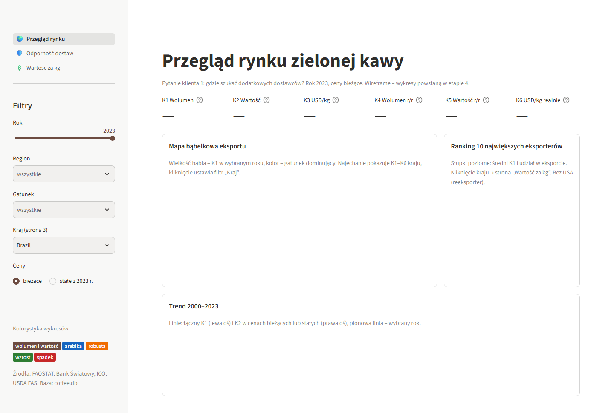

**Strona 2 – Odporność dostaw** (które kraje utrzymują eksport mimo słabszych zbiorów?). Karty pokazują K10 i liczbę słabszych lat oraz wskaźniki pogodowe jako tło. Wykres zestawia zmianę zbiorów ze zmianą eksportu, z przełącznikiem „ten sam rok / rok później”. Ranking dostawców wyróżnia trzy rekomendowane kraje.

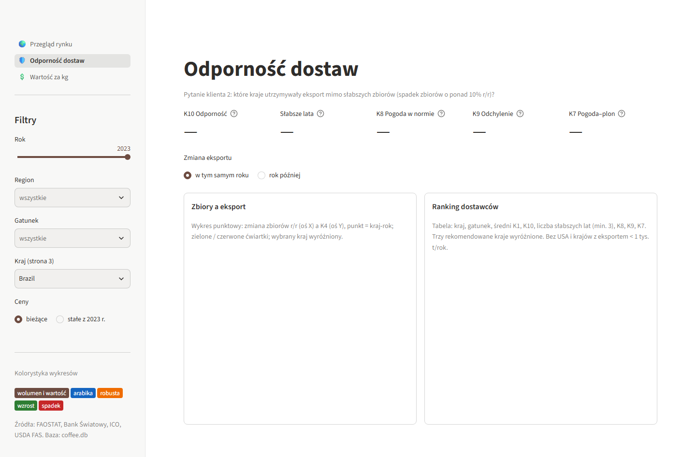

**Strona 3 – Wartość za kg** (jak zmieniała się wartość za kilogram?). Linia wartości za kg wybranego kraju na tle światowej ceny jego gatunku pokazuje, czy kraj sprzedaje drożej, czy taniej od rynku. Słupki dzielą zmianę wartości eksportu na część z ilości i część z ceny (M1).

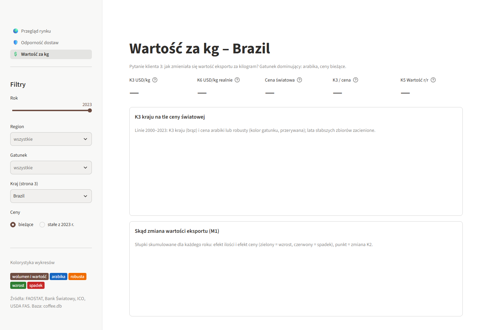

## 8. Porównanie systemów BI

Porównaliśmy trzy popularne narzędzia BI (Power BI, Tableau, Looker Studio) oraz Pythona z bibliotekami Streamlit i Plotly. Uwzględniliśmy potrzeby klienta – małej hurtowni bez działu IT, która tylko przegląda raport przez link – oraz założenie, że projekt powstaje w całości w Pythonie. Ceny i możliwości sprawdziliśmy 16.11.2026 na stronach producentów.

**Kryteria i wagi:** integracja z naszymi danymi (baza SQLite, wskaźniki w SQL i Pythonie) 25%, możliwości obliczeń (zmiany rok do roku, mediany, ceny stałe) 20%, koszt 15%, publikacja i współpraca 15%, wykresy i interakcje 15%, łatwość obsługi 10%.

| Kryterium (waga) | Power BI | Tableau | Looker Studio | Python (Streamlit + Plotly) |
|---|---|---|---|---|
| Integracja (25%) | 2 – SQLite tylko przez dodatkowy sterownik; wskaźniki trzeba napisać drugi raz | 2 – SQLite tylko w płatnej wersji i przez sterownik | 1 – nie łączy się z SQLite; potrzebna kopia danych | 5 – czyta bazę bezpośrednio, te same wskaźniki co raport |
| Obliczenia (20%) | 5 – bardzo dobre funkcje do porównań w czasie | 4 – dobre, ale mediany i porównania z poprzednim rokiem wymagają wprawy | 2 – tylko proste obliczenia | 5 – dowolne obliczenia w SQL i Pythonie |
| Koszt (15%) | 3 – program darmowy, ale udostępnianie kosztuje 14 USD/mies. za każdą osobę | 2 – 75 USD/mies.; darmowa wersja nie jest do użytku komercyjnego | 5 – darmowy | 5 – darmowy, także hosting |
| Publikacja (15%) | 3 – link tylko dla osób z licencją | 4 – łatwy link, ale wersja darmowa publikuje dane publicznie | 5 – link w przeglądarce | 4 – publiczny link; aplikacja usypia po 12 h bez ruchu |
| Wykresy (15%) | 4 – bogaty wybór, mapy | 5 – najlepsza jakość wykresów | 3 – podstawowe wykresy | 4 – interaktywne wykresy i mapy, układ trzeba zaprogramować |
| Łatwość (10%) | 4 – tworzenie metodą „przeciągnij i upuść” | 3 – dłuższa nauka | 4 – prosty edytor | 3 – oglądanie proste, zmiany wymagają programowania |
| **Wynik (skala 1–5)** | **3,40** | **3,25** | **3,00** | **4,50** |

Wynik nie zależy od wybranych wag: przy wagach równych, przy wagach z planu i przy podwójnej wadze kosztu i publikacji Python również wygrywa (4,33–4,50 punktu).

**Krótka charakterystyka narzędzi**

- **Power BI** – najlepsze modelowanie danych i standard w firmach. Minusy: działa tylko na Windows, z SQLite łączy się przez dodatkowy sterownik, a każdy odbiorca udostępnionego raportu potrzebuje płatnej licencji.
- **Tableau** – najładniejsze wykresy i darmowa publikacja otwartych danych (Tableau Public). Minusy: najdroższe, a wersja darmowa nie łączy się z SQLite i nie jest do użytku komercyjnego.
- **Looker Studio** – darmowe, działa w przeglądarce, łatwo udostępnić link. Minusy: nie łączy się z SQLite, a obliczeń między latami nie da się w nim wygodnie zrobić.
- **Python (Streamlit + Plotly)** – dashboard czyta te same dane i wzory co raport, kod jest wersjonowany w Git, a licencje i hosting są darmowe. Minusy: każdą zmianę trzeba zaprogramować, a darmowy hosting ma limity.

## 9. Rekomendacja narzędzia (System Recommendation Note)

**Kontekst.** Hurtownia zielonej kawy szuka dodatkowych dostawców. Potrzebuje dashboardu z rankingiem krajów, odpornością eksportu i wartością za kilogram w cenach bieżących i stałych. Dane i wzory wskaźników są już w bazie SQLite i w Pythonie.

**Porównanie i wynik.** Cztery narzędzia oceniliśmy według sześciu kryteriów w skali 1–5. Python ze Streamlit i Plotly uzyskał 4,50 punktu, Power BI 3,40, Tableau 3,25, a Looker Studio 3,00.

**Najważniejsze obserwacje.**

- Klasyczne narzędzia BI wymagałyby kopii danych albo dodatkowego sterownika oraz drugiego zapisu wzorów wskaźników. Łatwo wtedy o różne liczby w raporcie i na dashboardzie.
- Power BI liczy najlepiej, ale udostępnienie raportu klientowi kosztuje 14 USD miesięcznie za każdą osobę.
- Tableau ma najładniejsze wykresy, ale jest najdroższe.
- Looker Studio jest darmowe, ale zbyt słabe w obliczeniach między latami.

**Rekomendacja.** Dashboard budujemy w Pythonie: Streamlit jako strona z filtrami, Plotly do wykresów i mapy, baza `data/coffee.db` jako jedyne źródło danych. Publikujemy go bezpłatnie na Streamlit Community Cloud jako aplikację publiczną. Dane są otwarte (FAO, Bank Światowy, ICO), więc publiczny link nie jest problemem.

**Ryzyka i ograniczenia.**

- Każda zmiana dashboardu wymaga programisty – dlatego układ trzech stron od początku odpowiada na wszystkie pytania klienta.
- Darmowa aplikacja usypia po 12 godzinach bez ruchu i trzeba ją obudzić jednym kliknięciem – przed prezentacją otwieramy ją wcześniej.
- Darmowy hosting ma limit pamięci (do 2,7 GB), ale nasza baza ma tylko 192 KB.
- Gdyby klient chciał sam budować raporty, najlepszą alternatywą jest Power BI (drugie miejsce).

**Dalsze kroki.** (1) Etap 3: sprawdzenie podejrzanych wartości i dokończenie czyszczenia danych. (2) Etap 4: pełny dashboard na podstawie wireframe’u i publikacja online. (3) Test dashboardu przez osobę spoza zespołu.

## Załącznik A. Słownik danych

Typy kolumn: TEXT – tekst, INTEGER – liczba całkowita, REAL – liczba z częścią dziesiętną.

| Tabela | Kolumna | Typ | Jednostka | Znaczenie | Źródło | Uwagi |
|---|---|---|---|---|---|---|
| fact_country_year | iso3 | TEXT | – | kod kraju (ISO3) | ONZ M49 | klucz (razem z year) |
| fact_country_year | year | INTEGER | rok | rok | – | klucz (razem z iso3) |
| fact_country_year | area_ha | REAL | ha | powierzchnia zbiorów kawy | FAOSTAT | wymagane |
| fact_country_year | production_t | REAL | t | zbiory zielonej kawy | FAOSTAT | wymagane, ≥ 0 |
| fact_country_year | yield_kg_ha | REAL | kg/ha | plon | FAOSTAT | wymagane |
| fact_country_year | yield_deviation_pct | REAL | % | odchylenie plonu od trendu kraju 2000–2023 | obliczone | wymagane |
| fact_country_year | export_t | REAL | t | wolumen eksportu (K1) | FAOSTAT | wymagane, ≥ 0 |
| fact_country_year | export_value_usd | REAL | USD | wartość eksportu, przeliczona z tys. USD (K2) | FAOSTAT | wymagane, ≥ 0 |
| fact_country_year | temperature_c | REAL | °C | średnia roczna temperatura w kraju | Bank Światowy (ERA5) | wymagane |
| fact_country_year | precipitation_mm | REAL | mm | roczna suma opadów w kraju | Bank Światowy (ERA5) | wymagane |
| fact_country_year | temperature_anomaly_c | REAL | °C | różnica od średniej kraju z lat 1991–2020 | obliczone | wymagane |
| fact_country_year | precipitation_anomaly_pct | REAL | % | różnica od średniej kraju z lat 1991–2020 | obliczone | wymagane |
| fact_country_year | area_flag, production_flag, yield_flag, export_t_flag, export_value_flag | TEXT | – | pochodzenie wartości: A – oficjalna, E – szacunek, I – uzupełniona, X – z innego źródła | FAOSTAT | wymagane |
| dim_country | iso3 | TEXT | – | kod kraju (ISO3) | ONZ M49 | klucz |
| dim_country | country | TEXT | – | nazwa kraju według FAO | FAOSTAT | wymagane |
| dim_country | m49 | TEXT | – | kod kraju według ONZ | ONZ M49 | wymagane |
| dim_country | region | TEXT | – | kontynent | ONZ M49 | wymagane |
| dim_country | subregion | TEXT | – | region, np. South America | ONZ M49 | wymagane |
| dim_country | ico_type | TEXT | – | typ kawy: A – arabika, R – robusta, A/R – głównie arabika, R/A – głównie robusta | ICO | może być puste |
| dim_country | species | TEXT | – | dominujący gatunek (arabica / robusta) | ICO, USDA | może być puste |
| dim_country | species_source | TEXT | – | skąd pochodzi gatunek | ICO, USDA | puste, gdy brak gatunku |
| dim_country | temperature_norm_sd_c | REAL | °C | typowe wahanie temperatury kraju w latach 1991–2020 (granica „normy” w K8) | obliczone | wymagane |
| dim_country | precipitation_norm_sd_pct | REAL | % | typowe wahanie opadów kraju w latach 1991–2020 (granica „normy” w K8) | obliczone | wymagane |
| dim_year | year | INTEGER | rok | rok | – | klucz |
| dim_year | cpi_usa | REAL | 2010 = 100 | wskaźnik cen w USA (inflacja) | Bank Światowy | wymagane |
| dim_year | to_usd_2023 | REAL | – | mnożnik do cen z 2023 r. | obliczone | wymagane |
| dim_year | arabica_usd_kg, robusta_usd_kg | REAL | USD/kg | światowa cena arabiki i robusty | Bank Światowy | wymagane, > 0 |
| ref_weather_optimum | species | TEXT | – | gatunek kawy | – | klucz |
| ref_weather_optimum | temperature_min_c, temperature_max_c | REAL | °C | zakres optymalnej średniej rocznej temperatury | DaMatta i Ramalho (2006) | wymagane |
| ref_weather_optimum | precipitation_min_mm, precipitation_max_mm | REAL | mm | zakres optymalnej rocznej sumy opadów | DaMatta i Ramalho (2006) | wymagane |
| ref_weather_optimum | source | TEXT | – | pełne źródło zakresów | – | wymagane |
| weather_yield_correlation | iso3 | TEXT | – | kod kraju (ISO3) | ONZ M49 | klucz |
| weather_yield_correlation | yield_temperature_r, yield_precipitation_r | REAL | od −1 do 1 | korelacja plonu z temperaturą i z opadami (K7) | obliczone | – |
| weather_yield_correlation | temperature_paired_years, precipitation_paired_years | INTEGER | lata | liczba lat użytych do korelacji | obliczone | wymagane |

## Załącznik B. Pliki projektu

| Plik | Co zawiera |
|---|---|
| `notebooks/01_coffee_climate.ipynb` | zbiory i pogoda (etap 1) |
| `notebooks/02_build_database.ipynb` | pobranie danych i budowa bazy |
| `notebooks/03_quality_eda.ipynb` | jakość danych, EDA i tabela wskaźników |
| `sql/schema.sql`, `sql/views.sql` | struktura bazy i wzory wskaźników |
| `data/coffee.db` | baza danych SQLite |
| `dashboard/app.py` | szkielet dashboardu (wireframe) |
| `docs/raport-cw2/` | ten raport, wykresy i tabele |
