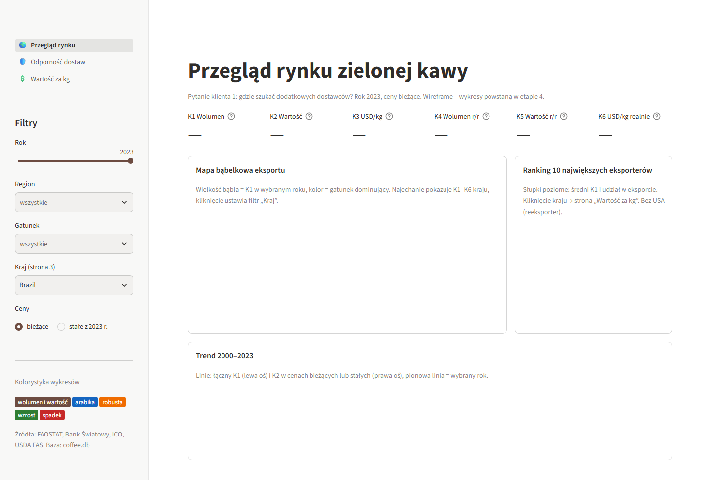
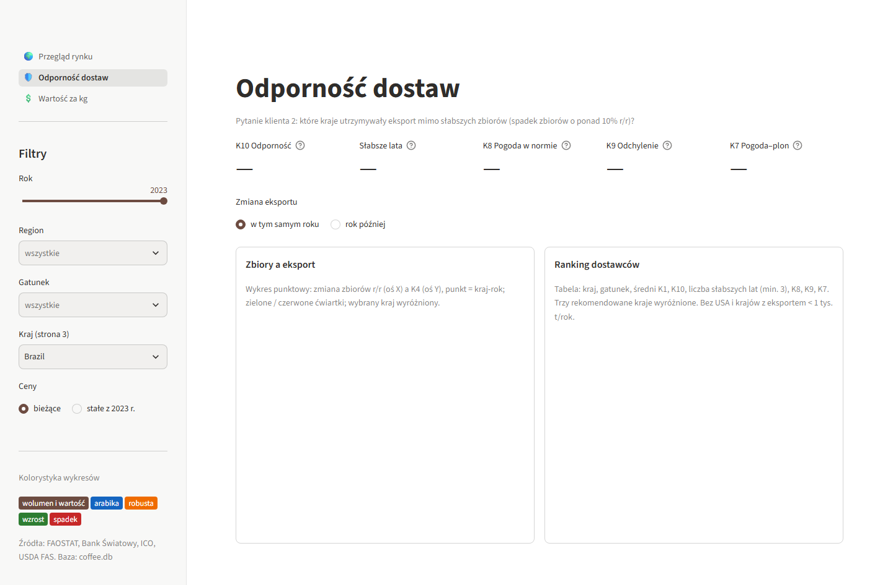
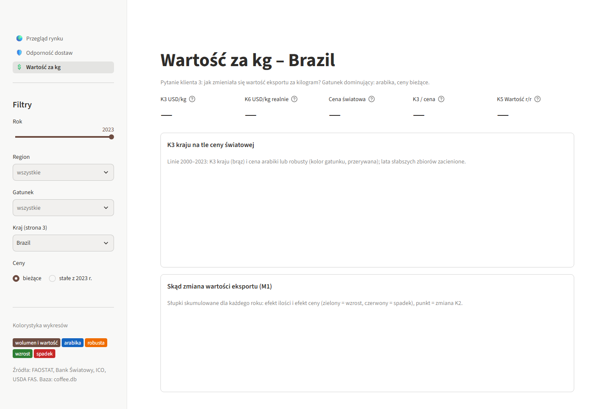

# Wireframe dashboardu

Wireframe to działający szkielet aplikacji Streamlit (`dashboard/app.py`). Filtry pobierają prawdziwe listy krajów, regionów i lat z bazy `data/coffee.db`. W miejscu wykresów są podpisane ramki z opisem docelowej zawartości, a karty KPI pokazują „—”. Z tego samego pliku powstanie dashboard w etapie 4.

**Układ wspólny dla wszystkich stron:**
- **Nawigacja** w lewym górnym rogu prowadzi do trzech stron, po jednej na każde pytanie klienta.
- **Filtry** w pasku bocznym obowiązują na wszystkich stronach: rok (suwak), region, gatunek, kraj (dla strony 3) oraz przełącznik cen bieżących i stałych z 2023 r.
- **Karty KPI** stoją na górze każdej strony, a pod nimi są wykresy.
- **Kolorystyka:**
  - brąz dla wolumenu i wartości,
  - niebieski dla arabiki, pomarańczowy dla robusty (ten sam kolor na wszystkich wykresach),
  - zielony i czerwony wyłącznie dla wzrostów i spadków.

## Strona 1. Przegląd rynku

Odpowiada na pytanie, gdzie szukać dostawców. Karty pokazują K1–K6 dla roku wybranego suwakiem. Mapa bąbelkowa pokazuje skalę eksportu i gatunek każdego kraju, a ranking 10 największych eksporterów prowadzi po kliknięciu na stronę 3. Wykres trendu 2000–2023 daje kontekst wybranego roku.

## Strona 2. Odporność dostaw

Odpowiada na pytanie, które kraje utrzymują eksport mimo słabszych zbiorów. Karty pokazują K10 i liczbę słabszych lat wybranego kraju oraz K7–K9 jako kontekst pogodowy. Wykres punktowy z przełącznikiem „ten sam rok / rok później” sprawdza H1. Ranking dostawców wymaga co najmniej 3 słabszych lat i wyróżnia trzy rekomendowane kraje.

## Strona 3. Wartość za kg

Odpowiada na pytanie, jak zmieniała się wartość eksportu za kilogram w kraju wybranym filtrem lub kliknięciem w rankingu. Linia K3 na tle ceny światowej jego gatunku pokazuje premię lub dyskonto. Słupki M1 rozdzielają zmianę wartości na efekt ilości i efekt ceny. Przełącznik cen zmienia wszystkie kwoty na dolary z 2023 r.

**Uruchomienie:** `.venv\Scripts\python.exe -m streamlit run dashboard/app.py` → http://localhost:8501
